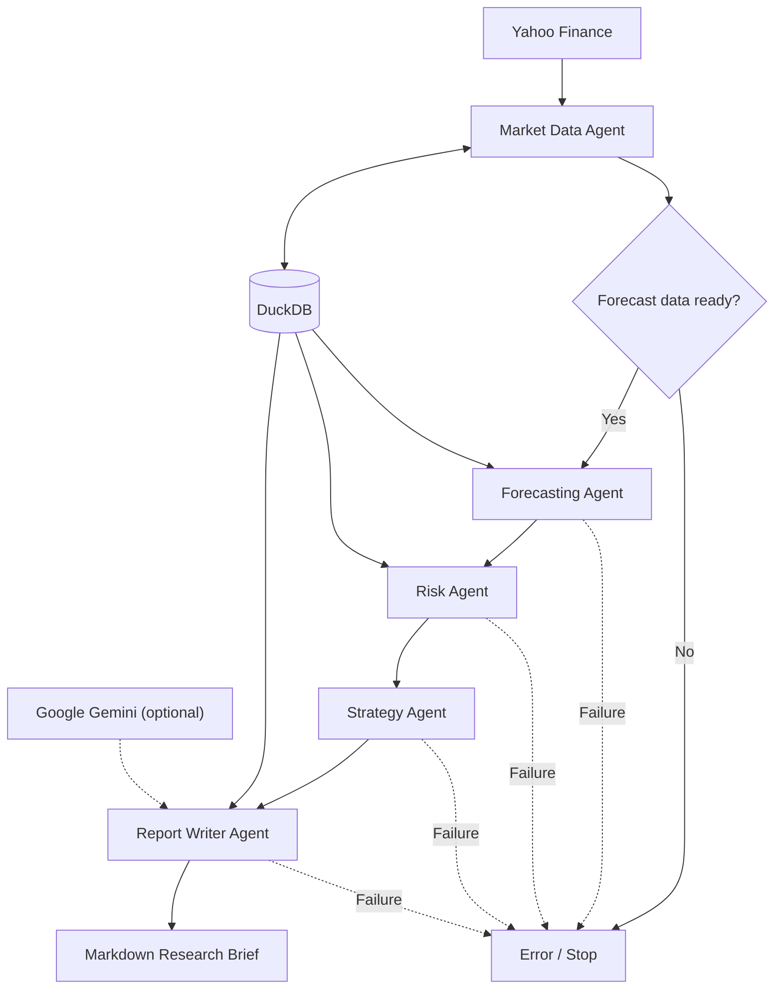
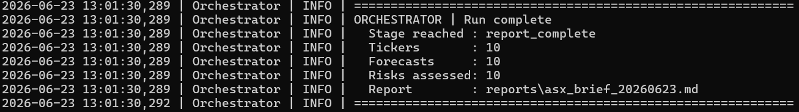
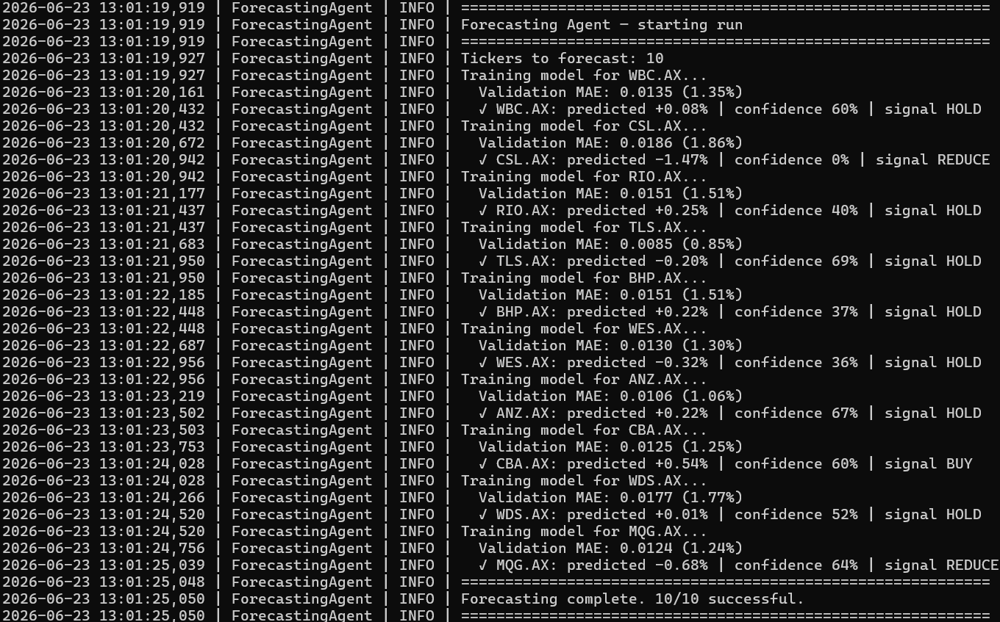
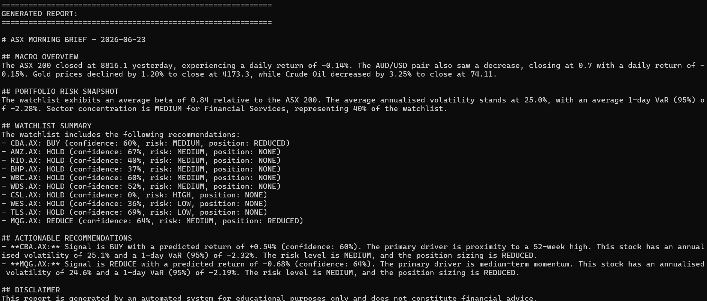

# ASX Equity Intelligence Agent


**A five-agent, Python-based equity research workflow for the Australian Securities Exchange (ASX).**

The application collects and validates market data, engineers predictive features, forecasts next-session equity returns, evaluates financial risk, applies deterministic recommendation rules and produces a structured Markdown research brief.

It combines quantitative analysis, LangGraph orchestration, local DuckDB storage and optional Google Gemini commentary.

**Project status:** End-to-end workflow validated locally. The automated regression suite contains 70 passing tests with 71% statement coverage, measured on Python 3.12.

> **Research and engineering demonstration only.** This project does not execute trades, manage a live investment portfolio or establish that its forecasts generate profitable investment strategies.

## Overview

The ASX Equity Intelligence Agent addresses a common research-engineering challenge: turning raw financial time-series data into a reproducible, structured decision-support report.

Rather than using a language model to make trading decisions, the application separates responsibilities into five specialised agents.

| Agent | Responsibility | Implementation |
|---|---|---|
| Market Data | Download, validate and persist equity, macroeconomic and company data | `agents/market_data_agent.py` |
| Forecasting | Engineer features, validate and train Random Forest models, and estimate next-session returns | `agents/forecasting_agent.py` |
| Risk | Calculate historical volatility, Value at Risk, beta, drawdown and watchlist concentration | `agents/risk_agent.py` |
| Strategy | Apply deterministic signal resolution, confidence filtering and position-adjustment rules | `agents/strategy_agent.py` |
| Report Writer | Generate an auditable Markdown briefing with optional constrained AI commentary | `agents/report_writer_agent.py` |

`orchestrator.py` coordinates the agents through LangGraph using shared typed state and conditional error routing.

The system is a structured multi-stage workflow, not an autonomous trading platform.

### Key engineering features

- Five-stage LangGraph workflow with explicit failure handling.
- Yahoo Finance ingestion with adjusted equity prices.
- Pydantic validation and transactional DuckDB persistence.
- Completed-session data handling and freshness checks.
- Equity-to-ASX 200 benchmark-date alignment.
- Eleven engineered forecasting features.
- Time-ordered validation with a one-observation target-boundary purge.
- One Random Forest model per equity.
- Forecast evaluation against a zero-return baseline.
- Date-aligned beta and historical downside-risk calculations.
- Deterministic `BUY`, `HOLD` and `REDUCE` recommendations.
- Optional Gemini commentary that does not determine quantitative outputs.
- Offline unit and integration testing using synthetic market data.
- Automated tests configured for GitHub Actions.

## Architecture



### Workflow stages

1. **Market Data:** Refresh the configured equity watchlist, market benchmark, macro series and company fundamentals.
2. **Readiness Assessment:** Check that the observations required for forecasting are sufficiently fresh and date-aligned.
3. **Forecasting:** Train and validate a model per eligible ticker, then estimate its next-session return.
4. **Risk:** Evaluate market sensitivity, volatility, downside risk and watchlist composition.
5. **Strategy:** Combine forecast signals with risk modifiers and confidence thresholds.
6. **Reporting:** Save a deterministic research brief and, when enabled, add constrained Gemini commentary.

Readiness assessment is part of the market-data stage. The application contains five analytical agents, not six.

A critical stage failure is routed through the workflow's error handling rather than silently producing an apparently successful report.

## Market data

### ASX equity watchlist

The default watchlist contains ten ASX-listed securities.

| Ticker | Company | Broad sector |
|---|---|---|
| `ANZ.AX` | ANZ Group | Financials |
| `BHP.AX` | BHP Group | Materials |
| `CBA.AX` | Commonwealth Bank | Financials |
| `CSL.AX` | CSL | Healthcare |
| `MQG.AX` | Macquarie Group | Financials |
| `RIO.AX` | Rio Tinto | Materials |
| `TLS.AX` | Telstra | Telecommunications |
| `WBC.AX` | Westpac | Financials |
| `WDS.AX` | Woodside Energy | Energy |
| `WES.AX` | Wesfarmers | Consumer |

Sector names above are descriptive. The sector-concentration calculation uses metadata supplied by Yahoo Finance, which may use different labels.

### Macroeconomic series

| Symbol | Series | Purpose |
|---|---|---|
| `^AXJO` | S&P/ASX 200 Index | Equity-market benchmark and forecasting feature |
| `AUDUSD=X` | AUD/USD exchange rate | Report context |
| `GC=F` | Gold futures | Report context |
| `CL=F` | WTI crude oil futures | Report context |

The ASX 200 is required for benchmark-aligned forecasting. The other macro series provide research context and may follow different market calendars.

### Validation and persistence

Market data is retrieved through `yfinance`, with `auto_adjust=True` for adjusted equity OHLC data.

The ingestion layer:

- validates prices, volumes and daily returns;
- obtains preceding closing prices to calculate in-window returns;
- excludes incomplete current-session observations;
- checks the age of the latest available data;
- stores records using ticker/date uniqueness;
- uses transactional database writes;
- identifies equity observations that cannot be matched to benchmark dates;
- retains otherwise valid equity observations even when forecasting is blocked;
- records failures and warnings separately from successful ingestion.

**Ingestion success does not automatically imply forecast readiness.**

For example, equity data can be persisted even if the ASX 200 benchmark is missing a required session. The affected security is then excluded from forecasting for that run.

The current readiness logic compares downloaded histories. A separate post-persistence integrity verification against fresh database reads remains a future improvement.

### DuckDB schema

The application stores information in three tables.

| Table | Data |
|---|---|
| `ohlcv` | Equity prices, volume and daily returns |
| `macro` | Benchmark and macro closing values and returns |
| `fundamentals` | Timestamped company metadata and fundamental snapshots |

Local DuckDB files are development and runtime data, not credentials or source code. They are excluded from Git in the current repository configuration.

## Forecasting methodology

### Model

Each eligible security receives a separate `RandomForestRegressor`.

```python
RandomForestRegressor(
    n_estimators=200,
    max_depth=6,
    min_samples_leaf=5,
    random_state=42,
)
```

The model estimates the return associated with the next available trading observation.

Conceptually:

```python
target = daily_return.shift(-1)
```

The latest row does not have a known next-session return. It is retained for inference rather than incorrectly used as a labelled training example.

### Engineered features

Eleven explanatory features describe momentum, volatility, volume, price position and market context.

| Feature | Meaning |
|---|---|
| `return_5d` | Five-observation price return |
| `return_10d` | Ten-observation price return |
| `return_20d` | Twenty-observation price return |
| `volatility_20d` | Rolling 20-observation return volatility |
| `rsi_14` | Fourteen-observation Relative Strength Index |
| `volume_ratio` | Current volume relative to its 20-observation average |
| `dist_52w_high` | Distance from the rolling 252-observation high |
| `dist_52w_low` | Distance from the rolling 252-observation low |
| `ma_crossover` | Relative difference between 10- and 50-observation moving averages |
| `asx200_return` | Current ASX 200 return |
| `asx200_return_5d` | Five-observation mean ASX 200 return |

### Model validation

The forecasting implementation uses chronological holdout validation:

1. Engineer features and construct next-observation targets.
2. Exclude incomplete training observations.
3. Reserve approximately the last 20% of labelled observations for validation.
4. Purge the observation at the training/validation target boundary to prevent label leakage.
5. Fit preprocessing on the training partition and apply it to the validation partition.
6. Evaluate model predictions using mean absolute error (MAE).
7. Compare performance with a simple zero-return baseline.
8. Refit on all eligible labelled observations before forecasting from the latest feature row.

The chronological split is safer than randomly shuffling financial time-series observations.

However, **one chronological holdout is not equivalent to a repeated rolling backtest**. Results remain sensitive to the selected period and market regime.

### Confidence interpretation

The displayed confidence score is derived from the spread of the individual Random Forest tree predictions.

Conceptually:

```python
confidence = clip(
    1 - tree_prediction_std / 0.02,
    0,
    1,
)
```

This score measures **model agreement**, not the statistical probability that a prediction will be correct.

It has not been calibrated against realised outcomes and must not be presented as a reliable success probability.

### Forecast signals

| Predicted next-session return | Raw signal |
|---|---|
| Greater than +0.5% | `BUY` |
| Between -0.5% and +0.5%, inclusive | `HOLD` |
| Less than -0.5% | `REDUCE` |

These are intermediate model-derived signals. The final recommendations may change after risk and confidence checks.

## Risk analysis

The risk agent evaluates each security using available historical observations.

| Metric | Method |
|---|---|
| Annualised volatility | Daily return standard deviation multiplied by the square root of 252 |
| Historical VaR, 95% | Fifth percentile of daily returns |
| Historical VaR, 99% | First percentile of daily returns |
| Maximum drawdown | Worst historical peak-to-trough decline |
| Beta | Covariance of date-aligned equity and ASX 200 returns divided by benchmark variance |
| Risk-adjusted ranking score | Predicted daily return divided by daily volatility, multiplied by model-agreement confidence |

### Risk classifications

| Annualised volatility | Risk level |
|---|---|
| Below 20% | `LOW` |
| 20% to below 35% | `MEDIUM` |
| 35% or above | `HIGH` |

### Recommendation modifiers

| Condition | Modifier |
|---|---|
| Historical 95% VaR below -5% | `BLOCK` |
| High risk and model agreement below 40% | `DOWNGRADE` |
| Medium risk and model agreement below 25% | `DOWNGRADE` |
| Otherwise | `CONFIRM` |

The reported ranking score is called `sharpe_score` internally, but it is **not a conventional Sharpe ratio**. It does not use realised portfolio performance or a risk-free rate.

### Watchlist-level assessment

The application also reports:

- mean security beta;
- mean annualised security volatility;
- mean historical 95% security VaR;
- sector composition;
- concentration classification.

These statistics describe the **watchlist**, not a funded portfolio with specified holdings.

In particular, the average security VaR is not a portfolio VaR. Portfolio weights, cross-security dependencies and diversification effects are not modelled in that statistic.

## Strategy generation

Strategy decisions are deterministic. Gemini is not involved.

### Signal resolution

| Raw forecast | `CONFIRM` | `DOWNGRADE` | `BLOCK` |
|---|---|---|---|
| `BUY` | `BUY` | `HOLD` | `HOLD` |
| `HOLD` | `HOLD` | `HOLD` | `HOLD` |
| `REDUCE` | `REDUCE` | `HOLD` | `HOLD` |

A separate minimum model-agreement threshold of 30% also prevents low-confidence forecasts from becoming actionable recommendations.

### Position-adjustment heuristic

The default base adjustment is 10%.

Adjustments are scaled using model agreement and risk:

- confidence of at least 60%: multiply by 1.5;
- confidence from 45% to below 60%: multiply by 1.0;
- confidence below 45%: multiply by 0.5;
- medium risk: multiply by 0.75;
- high risk: multiply by 0.5.

The adjustment is capped at 15% of the reference portfolio value.

`HOLD` corresponds to no proposed adjustment. Labels such as `FULL`, `REDUCED` and `MINIMAL` describe heuristic adjustment sizes, not positions derived from a portfolio optimiser.

No capital-allocation optimisation or portfolio-wide position reconciliation is performed.

## Research report generation

The report writer produces a Markdown research brief containing:

- forecast origin and report-generation dates;
- macroeconomic context;
- watchlist risk summary;
- sector concentration;
- actionable signals;
- all final recommendations and rationales;
- analytical limitations;
- a financial-information disclaimer.

### Optional Gemini commentary

Google Gemini 2.5 Flash Lite can provide supplementary qualitative commentary.

The deterministic report contains the quantitative calculations. Gemini cannot authoritatively replace the application's stored forecasts, computed risk measures or final strategy signals.

The application supports generating reports **without Gemini**, and this is the recommended mode for reproducible testing.

The optional LLM path includes constraints on unsupported claims and numerical changes. Those safeguards do not establish complete factual reliability, and generated commentary should be reviewed.

## Verified execution example

A successful complete pipeline run was recorded on **18 November 2026**, using refreshed validation data through **17 November 2026**.

| Item | Recorded result |
|---|---|
| Report generated | 18 November 2026 |
| Forecast origin | 17 November 2026 |
| Equity securities processed | 10 |
| Forecast-ready securities | 10 |
| Forecasts generated | 10 |
| Risk assessments | 10 |
| Final recommendations | 1 BUY, 9 HOLD, 0 REDUCE |
| Market bias | `NEUTRAL` |
| Generated file | `reports/asx_brief_20261117.md` |
| Gemini | Disabled |

The recorded run completed the full LangGraph workflow and generated a Markdown report.

This is an **execution-validation example**, not a claim of predictive accuracy or profitability.

### Historical reproducibility

The original development database ended on **22 June 2026**.

Historical reports and earlier validation results therefore use a June forecast origin. The refreshed November validation database contains more recent observations.

The distinction is intentional:

- **Historical database:** Useful for reproducing the original analytical experiments.
- **Refreshed database:** Useful for validating ingestion and generating reports from subsequently available observations.

A report's **forecast origin** is the latest market observation used for inference. Its **generation date** is when the report was written. They need not be the same date.

The forecasting models have not shown consistent superiority over the zero-return baseline across all securities. A comprehensive historical backtest is still required before making claims about forecasting skill.

## Installation

### Requirements

- Python 3.11 or 3.12.
- An internet connection for live Yahoo Finance ingestion.
- A Gemini API key only when optional AI commentary is enabled.

The automated test suite has been validated locally on Python 3.12 and is configured to run on Python 3.11 and 3.12 in GitHub Actions.

### 1. Navigate to the project

This application currently resides inside the `projects` GitHub repository:

```text
projects/
  asx-equity-intelligence-agent/
```

From a clone of the repository:

```bash
cd asx-equity-intelligence-agent
```

### 2. Create a virtual environment

```bash
python -m venv .venv
```

Windows Command Prompt:

```cmd
.venv\Scripts\activate
```

macOS or Linux:

```bash
source .venv/bin/activate
```

### 3. Install dependencies

```bash
python -m pip install -r requirements.txt
```

For development and testing:

```bash
python -m pip install -r requirements-dev.txt
```

The dependency configuration includes `tzdata` to support timezone handling on systems that do not provide the required IANA timezone database.

### 4. Configure Gemini if required

Create a local `.env` file from `.env.example`.

Windows Command Prompt:

```cmd
copy .env.example .env
```

macOS or Linux:

```bash
cp .env.example .env
```

To enable Gemini commentary, set:

```dotenv
GEMINI_API_KEY=your_api_key_here
```

Do not commit populated `.env` files or API credentials.

The API key is not needed when running with `--no-llm`.

## Running the application

All commands below assume the current directory is `asx-equity-intelligence-agent`.

### Run the full pipeline

For a deterministic report without Gemini:

```bash
python orchestrator.py --mode run --no-llm
```

To specify a database:

```bash
python orchestrator.py --mode run --db data/asx_market_data.db --no-llm
```

The database path is configurable. The application creates or updates the database required by its ingestion stage.

### Run with optional Gemini commentary

After configuring `GEMINI_API_KEY`:

```bash
python orchestrator.py --mode run
```

### Run the market-data agent independently

```bash
python -m agents.market_data_agent --db data/asx_market_data.db
```

The ingestion command can report a non-success exit status when data is stored successfully but forecast-readiness conditions are not met. Check the detailed logs rather than interpreting every non-zero exit code as a complete ingestion failure.

### Run the application scheduler

```bash
python orchestrator.py --mode schedule --no-llm
```

The scheduler targets **07:00 Australia/Sydney time, Monday to Friday**.

Important operational limitations:

- The scheduling process must remain running.
- Weekdays do not necessarily correspond to ASX trading days.
- The application does not yet implement an exchange-holiday calendar.
- An operating-system or cloud scheduler is preferable for robust unattended execution.

### Run the report writer independently

The report writer also supports standalone operation with an existing database:

```bash
python -m agents.report_writer_agent --db asx_market_data.db --output-dir reports --no-llm
```

Standalone historical execution may use stale data already in the database. It is useful for testing and reproducibility but is not equivalent to a new ingestion-and-readiness-validated run.

## Automated testing

The project includes unit and integration tests for the analytical workflow.

### Run the complete suite

```bash
python -m pytest tests -v
```

### Run with statement coverage

```bash
python -m pytest tests -q --cov=agents --cov=orchestrator --cov-report=term-missing
```

### Latest verified local results

Test environment: **Windows, Python 3.12.0**.

| Metric | Result |
|---|---:|
| Tests collected | 70 |
| Tests passed | 70 |
| Tests failed | 0 |
| Total executable statements | 1,409 |
| Statements exercised | 997 |
| Overall statement coverage | 71% |

### Coverage by component

| Component | Statement coverage |
|---|---:|
| Forecasting | 82% |
| Market data | 77% |
| Strategy | 75% |
| LangGraph orchestrator | 74% |
| Risk | 60% |
| Report writer | 57% |
| **Overall** | **71%** |

Coverage represents executed statements, not proof that every behaviour is correct.

### Test design

The suite includes:

- numerical unit tests for signals, beta, VaR and drawdown;
- validation tests for malformed financial observations;
- database transaction and repeated-upsert tests;
- real Random Forest training against synthetic observations;
- DuckDB-backed forecasting, risk and strategy integration;
- mocked LangGraph success and failure paths;
- report file creation and filename-collision tests;
- offline Yahoo Finance response simulation;
- benchmark-gap and forecast-readiness tests.

Tests run without a Gemini key or a live market-data provider.

### Continuous integration

GitHub Actions is configured to run the ASX test suite on Python 3.11 and 3.12.

Because this application lives inside the `projects` repository, its workflow is defined at the repository root:

```text
projects/.github/workflows/asx-tests.yml
```

The workflow runs from the `asx-equity-intelligence-agent` subdirectory.

[View repository Actions](https://github.com/khalili-samani/projects/actions)

## Repository structure

The ASX application is a subproject of the `projects` repository.

```text
projects/
|-- .github/
|   `-- workflows/
|       `-- asx-tests.yml
|
`-- asx-equity-intelligence-agent/
    |-- agents/
    |   |-- __init__.py
    |   |-- market_data_agent.py
    |   |-- forecasting_agent.py
    |   |-- risk_agent.py
    |   |-- strategy_agent.py
    |   `-- report_writer_agent.py
    |
    |-- tests/
    |   |-- test_analytics.py
    |   |-- test_market_data.py
    |   |-- test_orchestrator.py
    |   |-- test_reporting.py
    |   |-- test_agent_integration.py
    |   |-- test_workflow_integration.py
    |   |-- test_report_integration.py
    |   `-- test_market_data_integration.py
    |
    |-- screenshots/
    |-- reports/
    |-- .env.example
    |-- .gitignore
    |-- orchestrator.py
    |-- requirements.txt
    |-- requirements-dev.txt
    |-- LICENSE
    `-- README.md
```

Runtime DuckDB files and newly generated research reports are excluded from Git by the current ignore rules. The workflow creates the data it needs when run in a properly configured environment.

## Screenshots

The repository includes screenshots from earlier development and validation runs. They illustrate the execution and reporting workflow, not current market predictions.

### Pipeline execution



### Forecasting



### Research brief



## Limitations

This project is deliberately conservative about the claims supported by its results.

### Forecasting and validation

- The model uses a chronological holdout, not repeated rolling or nested backtesting.
- Forecasting performance is not consistently better than the zero-return baseline.
- No validated trading return, hit rate or risk-adjusted profitability claim is made.
- Tree-agreement confidence is not statistically calibrated.
- Global feature importance does not establish a causal or local explanation of an individual prediction.
- Synthetic integration data validates software behaviour, not investment performance.

### Market data

- Yahoo Finance is not an institutional-grade or guaranteed-complete feed.
- Data quality, adjusted values, revisions and metadata depend on the provider.
- The current readiness check uses downloaded historical observations, not an independent persisted-database reconciliation.
- The application does not implement a complete ASX trading-session calendar.
- Provider outages and incomplete or delayed market histories can prevent forecasting.

### Risk and strategy

- Historical VaR and volatility may not represent future tail events.
- Mean security VaR is not portfolio VaR.
- Sector concentration is based on counts, not capital allocation.
- Position adjustments are heuristic rather than optimised.
- Transaction costs, spreads, slippage, liquidity constraints and tax are not incorporated.
- The application does not trade or connect to a brokerage account.

### Reporting and operations

- Gemini commentary is supplementary and not fully fact-verified.
- The scheduled process must remain active.
- Automated tests do not eliminate operational or modelling risk.
- No production monitoring, alerting or model-drift system is implemented.

## Development roadmap

Priority improvements include:

1. **Rolling historical backtesting:** Evaluate forecasts at multiple historical cut-off dates without look-ahead leakage.
2. **Forecast performance diagnostics:** Report directional accuracy, MAE stability, baseline-relative results and performance by market regime.
3. **Database reconciliation:** Recheck persisted observations and benchmark alignment before forecasting.
4. **ASX trading calendar:** Handle public holidays and exchange-specific session schedules.
5. **Portfolio-level risk:** Incorporate position weights, covariance and portfolio VaR.
6. **Uncertainty calibration:** Compare model-agreement scores with realised forecast accuracy.
7. **Execution-aware research:** Model turnover, transaction costs and liquidity constraints.
8. **Machine-readable outputs:** Persist forecasts, model metrics, strategy decisions and run metadata for further analysis.
9. **Operational monitoring:** Add run health, data freshness and model-drift alerts.
10. **LLM evaluation:** Strengthen factual validation of optional narrative commentary.

## Responsible use

The ASX Equity Intelligence Agent is a portfolio engineering and quantitative research demonstration.

All outputs should be treated as experimental analytical information. They are not personalised financial advice, guaranteed predictions or instructions to trade.

## Licence

Licensed under the MIT License. See [LICENSE](LICENSE).