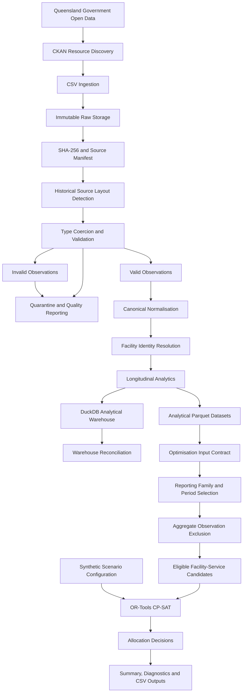
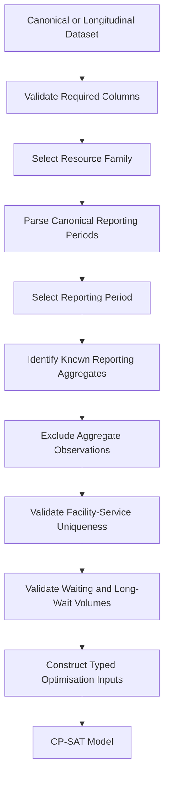

# Queensland Elective Surgery Capacity and Waitlist Recovery Optimiser


**An end-to-end data engineering, healthcare analytics and mathematical optimisation project using Queensland Government open data.**

This project investigates how hypothetical additional elective surgery capacity could be allocated across Queensland hospitals and surgical services to support waitlist recovery.

It integrates public healthcare statistics, reproducible data ingestion, historical schema adaptation, data-quality validation, dimensional modelling, longitudinal analytics and constrained mathematical optimisation within a modular Python application.

The system has been successfully executed against live Queensland Government data, producing a reconciled DuckDB analytical warehouse and an optimal capacity-allocation solution using Google OR-Tools CP-SAT.

**Current development milestone:** Phase 6.2 completed — optimisation input-contract hardening and aggregate-observation exclusion verified.

**Last verified:** 16 November 2026 (AEDT).

> This is an independent analytical and operations research portfolio project. It uses published aggregate healthcare statistics and synthetic capacity assumptions. It is not a clinical decision-making system or a Queensland Health production application.

---

## Table of contents

- [1. Project overview](#1-project-overview)
- [2. Verified results at a glance](#2-verified-results-at-a-glance)
- [3. Data source and analytical scope](#3-data-source-and-analytical-scope)
- [4. System architecture](#4-system-architecture)
- [5. Technology stack](#5-technology-stack)
- [6. Installation and quick start](#6-installation-and-quick-start)
- [7. Data ingestion and source provenance](#7-data-ingestion-and-source-provenance)
- [8. Historical schema compatibility](#8-historical-schema-compatibility)
- [9. Data validation and quarantine](#9-data-validation-and-quarantine)
- [10. Canonical analytical model](#10-canonical-analytical-model)
- [11. Longitudinal waitlist analytics](#11-longitudinal-waitlist-analytics)
- [12. DuckDB analytical warehouse](#12-duckdb-analytical-warehouse)
- [13. Optimisation input-contract hardening](#13-optimisation-input-contract-hardening)
- [14. Mathematical optimisation model](#14-mathematical-optimisation-model)
- [15. Baseline scenario configuration](#15-baseline-scenario-configuration)
- [16. Verified optimisation results](#16-verified-optimisation-results)
- [17. Allocation diagnostics and interpretation](#17-allocation-diagnostics-and-interpretation)
- [18. Reproducibility and generated outputs](#18-reproducibility-and-generated-outputs)
- [19. Repository structure](#19-repository-structure)
- [20. Automated testing and engineering quality](#20-automated-testing-and-engineering-quality)
- [21. Limitations and responsible interpretation](#21-limitations-and-responsible-interpretation)
- [22. Development roadmap](#22-development-roadmap)
- [23. Technical capabilities demonstrated](#23-technical-capabilities-demonstrated)
- [Acknowledgements](#acknowledgements)
- [Licence](#licence)

---

## 1. Project overview

### The planning problem

Elective surgery waiting lists are an important consideration in healthcare capacity planning.

Hospitals and surgical services differ in their reported:

- Waiting-list volumes.
- Long-wait volumes.
- Treatment activity.
- Relative long-wait burden.
- Changes in waiting demand over time.

Publicly available statistics can help describe these differences. However, translating published healthcare data into a mathematical capacity-allocation problem requires careful engineering, analytical modelling and explicit assumptions.

This project explores the following question:

> If a limited amount of additional elective surgery capacity were available, how could that capacity be allocated across eligible facilities and surgical services under a defined set of planning priorities and mathematical constraints?

The project addresses this question through five connected technical capabilities.

| Capability | Purpose |
| --- | --- |
| Data engineering | Discover, retrieve and preserve public healthcare data |
| Data quality | Validate historical source formats and analytical values |
| Analytics engineering | Standardise observations and derive longitudinal measures |
| Data warehousing | Build a reconciled DuckDB analytical database |
| Mathematical optimisation | Allocate hypothetical capacity under explicit constraints |

The primary objective is to demonstrate a reproducible and explainable workflow from public data acquisition to mathematical optimisation.

The project is not intended to predict individual patient outcomes, determine clinical urgency or recommend actual surgical schedules.

---

## 2. Verified results at a glance

The complete ingestion-to-optimisation pipeline has been successfully executed against live Queensland Government elective surgery resources.

### Data engineering and warehouse results

| Metric | Verified result |
| --- | ---: |
| Source resources discovered | 31 |
| Source resources successfully ingested | 31 |
| Category-level resources | 16 |
| Specialty-level resources | 15 |
| Source records processed | 11,021 |
| Records passing validation | 11,021 |
| Quarantined records | 0 |
| Canonical analytical records | 11,021 |
| Longitudinal analytical records | 11,021 |
| DuckDB fact records | 11,021 |
| Canonical duplicates removed | 0 |
| Facility dimension members | 108 |
| Specialty dimension members | 12 |
| Urgency-category dimension members | 4 |
| Distinct reporting periods | 16 |
| Warehouse row-count reconciliation | Passed |

Dimension counts include published reporting aggregates where applicable. They should not automatically be interpreted as counts of distinct operational hospitals or individual clinical specialties.

### Hardened optimisation results

| Metric | Verified result |
| --- | ---: |
| Scenario | `baseline_capacity_recovery` |
| Reporting period | June 2026 |
| Source family | Specialty |
| Original candidate observations | 321 |
| Aggregate observations excluded | 63 |
| Eligible detailed observations | 258 |
| Reported waiting volume across eligible observations | 58,912 |
| Reported long-wait volume across eligible observations | 5,804 |
| Hypothetical additional capacity | 100 cases |
| Hypothetical capacity allocated | 100 cases |
| Facility/service combinations receiving capacity | 6 |
| Facilities receiving hypothetical capacity | 4 |
| Unused capacity | 0 |
| Capacity utilisation | 100% |
| Mathematical objective value | 263,575 |
| CP-SAT solver status | Optimal |

### Engineering quality

| Quality gate | Verified result |
| --- | --- |
| Automated tests | 190 passed |
| Test failures | 0 |
| Test warnings | 0 |
| Ruff linting | Passed |
| mypy static type checking | Passed |
| Source files checked by mypy | 58 |
| Latest recorded test execution time | 2.20 seconds |

These results establish successful execution of the tested pipeline and baseline optimisation scenario.

They do not establish that additional surgeries were performed or that any observed healthcare outcomes changed.

---

## 3. Data source and analytical scope

### Primary data source

The project uses elective surgery statistics published through the Queensland Government Open Data portal.

**Dataset:** [Queensland Government Elective surgery](https://www.data.qld.gov.au/dataset/elective-surgery)

**CKAN API base:**

```text
https://www.data.qld.gov.au/api/3/action
```

**Dataset identifier:**

```text
d660d925-400f-42ba-8245-a08bfc18abf4
```

The ingestion system discovers eligible resources programmatically through the CKAN API rather than depending on a static collection of manually downloaded spreadsheets.

### Reporting families

The publisher provides two separate reporting families.

| Resource family | Reporting dimension |
| --- | --- |
| `category` | Elective surgery urgency category |
| `specialty` | Surgical specialty |

These represent different marginal views of elective surgery activity and waiting demand.

The analytical model retains the distinction between these reporting families.

For example, knowing the total number of patients waiting within an urgency category and the total number waiting within a surgical specialty does not establish the number belonging to both groups.

Consequently, the project does not fabricate a joint specialty-by-urgency-category distribution.

### Reporting coverage

The verified source snapshot includes:

- 31 published resources.
- 16 category resources.
- 15 specialty resources.
- 16 distinct reporting periods.
- Historical reporting observations extending through June 2026.

The number of available periods and resources may change as the publisher releases or revises data.

### Reporting aggregates

The source datasets include both detailed observations and aggregate reporting observations.

Examples include:

- Individual hospital and specialty observations.
- Individual hospital and urgency-category observations.
- All-specialty totals.
- All-category totals.
- Queensland Reporting Hospitals aggregates.

Aggregate observations are legitimate published statistics and remain available in the analytical warehouse.

However, they must not be interpreted as independent allocation destinations or summed indiscriminately together with their constituent observations.

### Data governance

The project uses publicly available aggregate statistics.

It does not process:

- Patient names.
- Individual patient identifiers.
- Personal medical histories.
- Patient-level waiting-list records.
- Individual clinical risk assessments.
- Patient-specific surgical scheduling decisions.

All optimisation decisions operate at an aggregate facility/service level.

---

## 4. System architecture

The application follows a layered architecture that separates source acquisition, validation, analytical processing and mathematical optimisation.



### Architectural principles

The design emphasises:

- Clear separation of responsibilities.
- Reproducible source acquisition.
- Preservation of original source files.
- Explicit validation rules.
- Traceable analytical transformations.
- Separation of observed data and synthetic assumptions.
- Consistent analytical grain.
- Testable optimisation components.
- Transparent reporting of mathematical results.

Each pipeline layer can be inspected and tested independently.

---

## 5. Technology stack

| Technology | Application |
| --- | --- |
| Python 3.12 | Core application development |
| Pandas | Data manipulation, parsing and analytical transformations |
| DuckDB | Embedded analytical database and SQL processing |
| Apache Parquet | Column-oriented analytical data storage |
| SQL | Dimensional modelling and warehouse reconciliation |
| Google OR-Tools | Mathematical optimisation |
| CP-SAT | Integer constrained capacity-allocation modelling |
| Pydantic | Configuration and scenario validation |
| YAML | Configurable modelling and pipeline assumptions |
| HTTPX | HTTP communication and API integration |
| Typer | Command-line interface |
| SHA-256 | Raw source content fingerprinting |
| pytest | Unit and integration testing |
| Ruff | Static code-quality checks |
| mypy | Static type checking |
| Git and GitHub | Version control and project documentation |

The application uses a modular `src/` package layout with separate engineering and optimisation components.

---

## 6. Installation and quick start

### 6.1 Requirements

- Python 3.12.
- Git.
- Internet access for live source discovery and ingestion.
- Sufficient local storage for generated datasets, raw source files and analytical outputs.

The configured Python compatibility range is:

```text
>=3.12,<3.13
```

### 6.2 Clone the repository

```bash
git clone https://github.com/khalili-samani/projects.git
cd projects/qld-elective-surgery-optimiser
```

### 6.3 Create a virtual environment

#### Windows CMD

```bat
py -3.12 -m venv .venv
.venv\Scripts\activate
```

#### macOS or Linux

```bash
python3.12 -m venv .venv
source .venv/bin/activate
```

### 6.4 Install the application

```bash
python -m pip install --upgrade pip
python -m pip install -e ".[dev]"
```

The editable installation allows changes to the project source code to be reflected in the active Python environment.

If multiple copies of the repository exist locally, verify the active package location before running the pipeline:

```bash
python -c "import qld_surgery_optimiser; print(qld_surgery_optimiser.__file__)"
```

### 6.5 Check the environment

```bash
python --version
python -m qld_surgery_optimiser.cli doctor
```

Display the available CLI commands:

```bash
python -m qld_surgery_optimiser.cli --help
```

### 6.6 Run the complete data pipeline

Execute the principal commands in order:

```bash
python -m qld_surgery_optimiser.cli doctor
python -m qld_surgery_optimiser.cli discover
python -m qld_surgery_optimiser.cli ingest
python -m qld_surgery_optimiser.cli validate
python -m qld_surgery_optimiser.cli warehouse
```

The warehouse command builds the analytical datasets required by the optimisation layer.

### 6.7 Run the baseline optimisation

#### Windows CMD

```bat
python -m qld_surgery_optimiser.cli optimise ^
  --analytical-data data\processed\longitudinal_performance.parquet ^
  --scenario configs\scenarios\optimisation_baseline.yml ^
  --output-dir reports\outputs\optimisation_hardened
```

#### macOS or Linux

```bash
python -m qld_surgery_optimiser.cli optimise \
  --analytical-data data/processed/longitudinal_performance.parquet \
  --scenario configs/scenarios/optimisation_baseline.yml \
  --output-dir reports/outputs/optimisation_hardened
```

An explicit reporting period can optionally be supplied using:

```text
--reporting-period 2026-06-01
```

Without this option, the optimisation contract selects the latest available reporting period for the requested source family and verifies that eligible detailed observations remain.

### 6.8 Available CLI commands

| Command | Purpose |
| --- | --- |
| `doctor` | Validate configuration and prepare required directories |
| `show-config` | Display resolved non-secret configuration |
| `discover` | Discover eligible CKAN resources |
| `ingest` | Download and archive source resources |
| `validate` | Validate observations and quarantine invalid rows |
| `warehouse` | Build canonical datasets and the analytical warehouse |
| `optimise` | Run a configured CP-SAT optimisation scenario |

---

## 7. Data ingestion and source provenance

The ingestion layer retrieves elective surgery data through the Queensland Government CKAN API.

Its responsibilities include:

- Dataset and resource discovery.
- Resource classification.
- CSV downloading.
- Source metadata capture.
- Version-aware raw storage.
- SHA-256 checksum calculation.
- Manifest maintenance.
- Reuse of existing downloaded content where applicable.

### Immutable raw storage

Downloaded source files are preserved in their original byte representation.

Cleaned or transformed datasets do not overwrite raw source files.

This separation supports:

- Source auditing.
- Historical reproducibility.
- Detection of changed source content.
- Troubleshooting of validation failures.
- Traceability between original and analytical observations.

### Source manifest

The ingestion manifest is stored at:

```text
data/raw/manifest.csv
```

Representative manifest fields include:

```text
dataset_id
dataset_title
source_organisation
source_licence
resource_id
resource_name
resource_kind
resource_format
source_url
source_hash
source_created
source_last_modified
retrieved_at
local_path
sha256
byte_count
content_type
```

The manifest connects downloaded content with its associated publisher metadata and source resource identity.

### Verified ingestion results

```text
Eligible resources:       31
Resources selected:       31
New files downloaded:     27
Already present:           4
Total manifest records:   31

Status: completed successfully
```

The ingestion system has therefore demonstrated successful operation against the documented live public-data snapshot, rather than only synthetic test fixtures.

---

## 8. Historical schema compatibility

Government datasets can change structure across reporting periods.

One of the engineering challenges addressed by this project is the presence of multiple historical CSV layouts within the same source catalogue.

The source-layout detector supports:

| Source layout | Supported |
| --- | --- |
| Current headered category CSV | Yes |
| Legacy uppercase category headers | Yes |
| Headerless category CSV | Yes |
| Category CSV with three trailing empty fields | Yes |
| Current headered specialty CSV | Yes |
| Headerless specialty CSV | Yes |

The historical category padding is accepted only when the corresponding additional fields are confirmed to be empty.

Unexpected layouts are rejected rather than silently interpreted using an uncertain column mapping.

### Why schema adaptation matters

An ingestion system designed exclusively around the current publisher layout may fail on historical resources or incorrectly associate values with analytical fields.

The source-layout adapter provides controlled schema normalisation while preserving the original downloaded files.

The implementation shares source-layout detection between the ingestion and validation layers to reduce contradictory assumptions about file structure.

---

## 9. Data validation and quarantine

The validation layer reads source values and applies explicit type coercion and quality rules.

The principal validation areas include:

- Required identifiers and business-key values.
- Numeric parsing.
- Percentage parsing.
- Reporting-period parsing.
- Non-negative activity and waiting volumes.
- Percentage semantics.
- Duplicate business keys.
- Long waits not exceeding total waiting volume.
- Consistency between long-wait components.
- Supported source structures.

Invalid observations can be quarantined together with their original values and associated quality-rule information.

### 9.1 Historical reporting-period normalisation

The upstream date-coercion layer supports multiple historical reporting-period representations.

| Original source value | Normalised value |
| --- | --- |
| `JUN2023` | `2023-06-01` |
| `Sep-24` | `2024-09-01` |
| `Jun-26` | `2026-06-01` |
| `16-Jan-2024` | `2024-01-16` |
| `07/11/2026` | `2026-11-07` |

Month-year values are represented using the first day of the corresponding month.

This is an analytical convention and does not imply that the underlying healthcare activity occurred on that exact date.

Australian day/month/year ordering is used for supported numeric date formats.

### 9.2 Percentage semantics

The validation rules distinguish between bounded proportions and percentage changes.

For example:

- A proportion treated within a specified time is expected to fall between 0% and 100%.
- A year-on-year percentage change can legitimately be negative or exceed 100%.

Consider the following example:

```text
Previous-year treatment volume: 10
Current treatment volume:       30

Percentage change:             +200%
```

Rejecting the variation because it exceeds 100% would incorrectly classify a potentially valid observation as a quality failure.

The validation rules therefore distinguish percentage-change measures from bounded percentage measures.

### 9.3 Verified validation results

```text
Files processed:       31
Files passed:          31
Files failed:           0

Rows read:          11021
Rows valid:         11021
Rows quarantined:       0

Rule counts: {}
```

All 11,021 source observations passed the implemented validation rules.

Zero quarantined rows means that no violations were detected under the configured rules. It does not constitute independent certification that the source data are free from every possible error.

The validation summary is generated at:

```text
reports/outputs/data_quality_summary.json
```

---

## 10. Canonical analytical model

The canonical processing layer transforms publisher-specific structures into a consistent analytical representation.

Representative canonical fields include:

| Field | Purpose |
| --- | --- |
| `facility_key` | Analytical facility identifier |
| `facility_name` | Resolved facility name |
| `report_month` | Normalised reporting period |
| `resource_kind` | Category or specialty source family |
| `service_code` | Published service identifier |
| `service_name` | Service description |
| `vol_treated` | Reported treatment volume |
| `vol_waiting` | Reported waiting volume |
| `vol_long_waits` | Reported long-wait volume |
| `source_resource_key` | Source resource lineage identifier |

### 10.1 Analytical grain

The canonical dataset is organised around the following dimensions:

```text
Facility
    × Reporting period
    × Resource family
    × Service
```

The service dimension belongs to one of the two published source families:

```text
resource_kind = specialty
```

or:

```text
resource_kind = category
```

Maintaining `resource_kind` explicitly prevents accidental interpretation of the source families as a jointly observed clinical distribution.

### 10.2 Facility identity resolution

Facility identities are resolved using deterministic mapping rules and reviewed reference data.

The design avoids unrestricted fuzzy matching, which could incorrectly associate observations from different hospitals.

Published reporting aggregates are retained as analytical entities where appropriate.

Their presence in the warehouse does not make them eligible operational allocation destinations.

### 10.3 Verified canonical results

```text
Canonical rows:                 11021
Canonical duplicates removed:       0
```

The verified canonical build retained all validated observations.

---

## 11. Longitudinal waitlist analytics

The longitudinal processing layer derives descriptive measures from observations across reporting periods.

### Derived analytical measures

| Measure | Definition |
| --- | --- |
| `previous_vol_waiting` | Waiting volume from the preceding available observation |
| `backlog_change` | Difference between current and previous waiting volume |
| `previous_vol_long_waits` | Long-wait volume from the preceding available observation |
| `long_wait_change` | Difference between current and previous long-wait volume |
| `long_wait_share` | Long-wait volume divided by waiting volume |
| `treatment_to_waiting_ratio` | Treatment volume divided by waiting volume |

### Mathematical definitions

Waiting-list change:

$$
\Delta W_{i,t} = W_{i,t} - W_{i,t-1}
$$

Long-wait change:

$$
\Delta L_{i,t} = L_{i,t} - L_{i,t-1}
$$

Long-wait share, where waiting volume is positive:

$$
P_{i,t} = \frac{L_{i,t}}{W_{i,t}}
$$

Treatment-to-waiting ratio, where waiting volume is positive:

$$
R_{i,t} = \frac{T_{i,t}}{W_{i,t}}
$$

Where:

- `i` represents a facility/service observation within one resource family.
- `t` represents a reporting period.
- `W` represents waiting volume.
- `L` represents long-wait volume.
- `T` represents treatment volume.

The preceding observation refers to the preceding available reporting observation, which is not necessarily the immediately preceding calendar month or quarter.

These measures support descriptive comparisons and do not establish causal relationships between treatment activity and waiting-list changes.

### Verified longitudinal results

```text
Longitudinal rows: 11021
```

The longitudinal processing stage retained the same number of observations as the canonical dataset.

---

## 12. DuckDB analytical warehouse

The project builds an embedded DuckDB analytical warehouse from the canonical and longitudinal datasets.

DuckDB provides a local SQL-based analytical environment without requiring a separate database server.

### 12.1 Dimension tables

The warehouse includes:

```text
dim_facility
dim_specialty
dim_urgency_category
dim_reporting_period
dim_source_resource
```

These dimensions provide consistent analytical entities and source lineage references.

### 12.2 Fact tables

```text
fact_elective_surgery_performance
fact_data_quality_event
```

The performance fact table contains elective surgery analytical observations.

The quality-event fact table supports recording data-quality events.

### 12.3 Generated analytical outputs

```text
data/processed/
    canonical_performance.parquet
    longitudinal_performance.parquet
    elective_surgery.duckdb

reports/outputs/
    warehouse_reconciliation.json
    warehouse_build_summary.json
```

### 12.4 Verified warehouse reconciliation

The live warehouse command generated the following reconciliation results:

```json
{
  "canonical_rows": 11021,
  "duplicate_canonical_keys_removed": 0,
  "facility_rows": 108,
  "fact_matches_longitudinal": true,
  "fact_rows": 11021,
  "longitudinal_rows": 11021,
  "quality_event_rows": 0,
  "reporting_period_rows": 16,
  "source_resource_rows": 31,
  "specialty_rows": 12,
  "urgency_category_rows": 4
}
```

The warehouse fact-record count matches the longitudinal dataset.

The verified run therefore demonstrates row-count reconciliation across the following stages:

```text
Validated observations       11,021
          |
          v
Canonical observations       11,021
          |
          v
Longitudinal observations    11,021
          |
          v
Warehouse fact observations  11,021
```

No canonical duplicates were removed in this execution.

The reconciliation establishes the reported record-count agreement. It does not independently validate every field-level transformation or foreign-key relationship against the original publisher data.

### 12.5 Querying the warehouse

List the available tables:

```bash
python -c "import duckdb; c=duckdb.connect('data/processed/elective_surgery.duckdb',read_only=True); print(c.execute('SHOW TABLES').fetchdf()); c.close()"
```

Verify the performance fact count:

```bash
python -c "import duckdb; c=duckdb.connect('data/processed/elective_surgery.duckdb',read_only=True); print(c.execute('SELECT COUNT(*) FROM fact_elective_surgery_performance').fetchone()); c.close()"
```

When querying healthcare volumes, analysts must explicitly select an appropriate source family and reporting grain.

Summing all records indiscriminately may combine overlapping reporting observations.

---

## 13. Optimisation input-contract hardening

### 13.1 The analytical problem

The detailed inspection of the initial baseline optimisation outputs revealed that the source datasets included overlapping levels of aggregation.

The original June 2026 specialty candidate population contained:

- Detailed facility/specialty observations.
- All-specialty totals for individual facilities.
- Queensland-wide specialty reporting aggregates.
- Queensland-wide all-specialty totals.

Although these observations are valid for appropriate reporting purposes, they should not be treated as independent operational allocation destinations.

Including them together introduces a risk of double counting both waiting demand and allocation opportunities.

### 13.2 Aggregate exclusion policy

The revised optimisation input contract excludes known reporting aggregates before constructing the CP-SAT model.

| Observation type | Retained in warehouse | Eligible for optimisation |
| --- | --- | --- |
| Individual facility/specialty observation | Yes | Yes |
| Individual facility/category observation | Yes | Yes, in category scenarios |
| All-specialty total | Yes | No |
| All-category total | Yes | No |
| Queensland Reporting Hospitals aggregate | Yes | No |

The policy uses explicit aggregate labels, including:

```text
ALL
All specialties
All categories
All urgency categories
Queensland Reporting Hospitals
```

Aggregate matching is case-insensitive and tolerant of surrounding or repeated whitespace.

Exact label matching is used instead of unrestricted substring matching.

For example, an actual facility name containing the letters `all` is not automatically classified as a reporting aggregate.

The policy addresses known aggregate labels in the supported data. Newly introduced publisher labels may require additional classification rules.

### 13.3 Verified candidate-selection results

The revised live optimisation generated the following audit information:

```text
source_rows=321
aggregate_service_rows=52
aggregate_facility_rows=12
overlapping_aggregate_rows=1
excluded_rows=63
eligible_rows=258
```

The exclusion count accounts for the row belonging to both aggregate classifications.

```text
Aggregate service observations:     52
Aggregate facility observations:    12
Overlapping classification:         -1
                                   ---
Unique excluded observations:       63
```

Consequently:

```text
Original candidates: 321
Excluded aggregates:  63
Eligible candidates: 258
```

This represents a 19.63% reduction in the optimisation candidate population.

### 13.4 Correction of overlapping waiting-volume counts

The original candidate population combined detailed observations with overlapping totals.

| Summed measure | Original candidates | Hardened candidates |
| --- | ---: | ---: |
| Waiting volume | 235,648 | 58,912 |
| Long-wait volume | 23,216 | 5,804 |

In the documented June 2026 specialty snapshot, the unfiltered candidate population produced totals four times larger than the corresponding detailed-only population.

The candidate-selection correction removed the identified fourfold counting.

The 75% reduction in summed candidate volumes is a correction of analytical aggregation, not a reduction in actual elective surgery waiting lists.

### 13.5 Hardened candidate-selection workflow



### 13.6 Additional contract safeguards

The hardened optimisation contract also provides:

- Explicit canonical ISO date parsing.
- Normalisation of timestamp time components.
- Required-field validation.
- Non-negative whole-number volume validation.
- Long waits not exceeding waiting volume.
- Facility/service uniqueness checks after whitespace normalisation.
- Preservation of the original analytical DataFrame.
- Structured candidate-exclusion logging.
- Explicit rejection of aggregate-only reporting periods.

If the latest selected reporting period contains no eligible detailed observations, the contract raises an error.

It does not silently fall back to an earlier reporting period.

Historical publisher-specific date formats are handled by the upstream validation layer, while the optimisation boundary expects canonical date representations.

---

## 14. Mathematical optimisation model

The optimisation layer uses Google OR-Tools CP-SAT to solve a constrained integer allocation problem.

Its purpose is to distribute a hypothetical amount of additional elective surgery activity across eligible facility/service combinations.

### 14.1 Optimisation grain

A single optimisation scenario operates on:

```text
One resource family
    × One reporting period
    × Eligible facility-service combinations
```

The allocation key is:

```text
facility_key × service_key
```

Category and specialty observations are never combined into a fabricated joint allocation population.

### 14.2 Model notation

| Symbol | Definition |
| --- | --- |
| $i$ | Eligible facility/service combination |
| $x_i$ | Hypothetical additional cases allocated to combination $i$ |
| $W_i$ | Observed waiting volume |
| $L_i$ | Observed long-wait volume |
| $C$ | Total hypothetical additional capacity |
| $U_i$ | Synthetic facility/service capacity ceiling |
| $w_R$ | General recovery weight |
| $w_L$ | Relative long-wait weight |
| $S$ | Integer objective scaling factor |
| $s_i$ | Integer-scaled long-wait share |
| $c_i$ | Objective coefficient for one additional allocated case |

### 14.3 Decision variables

The model defines a non-negative integer decision variable for every eligible facility/service combination.

$$
x_i \in \mathbb{Z}_{\geq 0}
$$

Each decision variable represents hypothetical additional activity.

It does not represent measured spare operating theatre capacity or an actual clinical scheduling decision.

### 14.4 Total capacity constraint

The total allocated activity must not exceed the scenario capacity budget.

$$
\sum_i x_i \leq C
$$

For the baseline scenario:

$$
C = 100
$$

### 14.5 Facility/service capacity ceiling

Where enabled, allocations cannot exceed the synthetic capacity ceiling for the corresponding facility/service combination.

$$
x_i \leq U_i
$$

The baseline scenario applies a maximum of 25 additional cases per facility/service combination.

$$
U_i = 25
$$

This is a hypothetical modelling assumption, not an observed operational limit.

### 14.6 Waiting-volume ceiling

Where enabled, the model cannot allocate more additional cases than the reported waiting volume for the corresponding observation.

$$
x_i \leq W_i
$$

With both optional ceilings enabled, the upper bound is:

$$
0 \leq x_i \leq \min(U_i,W_i)
$$

### 14.7 Integer-scaled long-wait share

The baseline objective derives a relative long-wait score from the observed long-wait and waiting volumes.

For observations with positive waiting volume:

$$
s_i =
\left\lfloor
\frac{S L_i}{W_i}
\right\rfloor
$$

For observations with zero waiting volume:

$$
s_i = 0
$$

The integer scaling factor is:

$$
S = 1000
$$

The implementation uses deterministic integer arithmetic to produce CP-SAT-compatible coefficients.

### 14.8 Objective coefficient

The objective assigns a benefit coefficient to each additional case:

$$
c_i = w_R S + w_L s_i
$$

The coefficient consists of:

1. A general recovery component.
2. A relative long-wait burden component.

### 14.9 Objective function

The CP-SAT model maximises the total weighted value of allocated hypothetical capacity.

$$
\max Z = \sum_i c_i x_i
$$

Substituting the coefficient definition:

$$
\max Z =
\sum_i x_i
\left(w_R S + w_L s_i\right)
$$

The baseline weights are:

$$
w_R = 1
$$

$$
w_L = 3
$$

The objective is a transparent mathematical preference function.

It is not a clinically validated measure of expected patient benefit.

### 14.10 Behaviour of the baseline objective

The general recovery component contributes the same base score to each allocated case.

It does not directly increase the objective coefficient for services with larger absolute waiting volumes.

When the full capacity budget is allocated:

$$
\sum_i x_i = C
$$

the general recovery component becomes constant across those solutions:

$$
w_R S \sum_i x_i = w_R S C
$$

Consequently, when comparing solutions that use the same total capacity, their relative ranking is driven by the scaled long-wait-share component, assuming a positive long-wait weight.

Absolute waiting volume remains relevant through the waiting-volume constraint but is not directly represented as an additional benefit term.

This distinction is important when interpreting the model and designing future sensitivity experiments.

---

## 15. Baseline scenario configuration

The baseline scenario is defined in:

```text
configs/scenarios/optimisation_baseline.yml
```

A representative configuration is:

```yaml
scenario:
  name: baseline_capacity_recovery
  description: >
    Synthetic baseline scenario for testing elective surgery
    capacity allocation across facility-service combinations.
  resource_kind: specialty
  synthetic_assumptions: true
  notes: >
    Capacity values in this scenario are modelling assumptions
    for portfolio demonstration and testing. They are not
    observed Queensland Health capacity values.

capacity:
  total_additional_cases: 100
  default_max_additional_cases_per_service: 25

objective:
  waiting_weight: 1
  long_wait_weight: 3

constraints:
  enforce_waiting_volume_ceiling: true
  enforce_service_capacity_ceiling: true

solver:
  max_time_seconds: 30
  num_search_workers: 1
  random_seed: 0
```

### Configuration components

| Component | Purpose |
| --- | --- |
| `scenario` | Scenario identity and reporting-family selection |
| `capacity` | Hypothetical additional capacity assumptions |
| `objective` | Mathematical preference weights |
| `constraints` | Enabled allocation restrictions |
| `solver` | Solver execution configuration |

The scenario contract explicitly requires:

```yaml
synthetic_assumptions: true
```

This reinforces the separation between observed healthcare information and hypothetical planning assumptions.

---

## 16. Verified optimisation results

The hardened baseline optimisation was executed against the longitudinal Parquet dataset derived from the live public source data.

### 16.1 Execution result

```text
Optimisation candidate selection:
    source_rows=321
    aggregate_service_rows=52
    aggregate_facility_rows=12
    overlapping_aggregate_rows=1
    excluded_rows=63
    eligible_rows=258

Optimisation completed successfully.

Scenario: baseline_capacity_recovery
Solver status: optimal

Capacity available: 100
Additional cases allocated: 100
Unused capacity: 0
Capacity utilisation: 100.0%
```

### 16.2 Original versus hardened baseline

| Metric | Original baseline | Hardened baseline |
| --- | ---: | ---: |
| Candidate observations | 321 | 258 |
| Identified aggregate candidates | 63 | 0 |
| Summed waiting volume | 235,648 | 58,912 |
| Summed long-wait volume | 23,216 | 5,804 |
| Hypothetical capacity available | 100 | 100 |
| Hypothetical cases allocated | 100 | 100 |
| Services receiving capacity | 6 | 6 |
| Facilities receiving capacity | 4 | 4 |
| Unused capacity | 0 | 0 |
| Capacity utilisation | 100% | 100% |
| Mathematical objective value | 263,575 | 263,575 |
| Solver status | Optimal | Optimal |

The hardened run preserved the original objective value and all six positive allocation decisions.

This demonstrates that the identified aggregates were successfully excluded without changing the baseline optimal allocation.

The result is specific to the tested scenario and analytical snapshot. Different scenario parameters may produce different allocation decisions.

### 16.3 Verified facility/service allocations

| Facility | Surgical specialty | Hypothetical additional cases |
| --- | --- | ---: |
| Rockhampton | ENT surgery | 25 |
| Rockhampton | General surgery | 25 |
| Townsville | ENT surgery | 25 |
| Townsville | Cardio-thoracic surgery | 22 |
| Weipa | Gynaecology | 2 |
| Hervey Bay | Urology | 1 |
| **Total** | | **100** |

### 16.4 Allocation distribution

```text
Rockhampton - ENT surgery           25 | #########################
Rockhampton - General surgery       25 | #########################
Townsville - ENT surgery            25 | #########################
Townsville - Cardio-thoracic         22 | ######################
Weipa - Gynaecology                   2 | ##
Hervey Bay - Urology                  1 | #

Total hypothetical additional cases: 100
```

### 16.5 Allocation by facility

| Facility | Additional cases | Share of allocation |
| --- | ---: | ---: |
| Rockhampton | 50 | 50% |
| Townsville | 47 | 47% |
| Weipa | 2 | 2% |
| Hervey Bay | 1 | 1% |
| **Total** | **100** | **100%** |

Rockhampton and Townsville receive 97% of the hypothetical baseline allocation.

This is a result of the configured objective, observed analytical values and synthetic constraints.

It is not an independently validated recommendation regarding actual healthcare resource distribution.

---

## 17. Allocation diagnostics and interpretation

The optimisation diagnostics layer connects observed input measures, mathematical constraints and resulting allocation decisions.

### 17.1 Positive allocation characteristics

The baseline diagnostic inspection identified the following observed values for the six services receiving hypothetical capacity.

| Facility | Specialty | Waiting volume | Long waits | Long-wait share | Allocated cases |
| --- | --- | ---: | ---: | ---: | ---: |
| Rockhampton | ENT surgery | 444 | 352 | 79.28% | 25 |
| Rockhampton | General surgery | 406 | 190 | 46.80% | 25 |
| Townsville | ENT surgery | 463 | 227 | 49.03% | 25 |
| Townsville | Cardio-thoracic surgery | 60 | 24 | 40.00% | 22 |
| Weipa | Gynaecology | 2 | 1 | 50.00% | 2 |
| Hervey Bay | Urology | 1 | 1 | 100.00% | 1 |

The same positive allocation decisions were preserved in the hardened baseline execution using the same analytical input dataset.

### 17.2 Relative versus absolute long-wait burden

The baseline objective prioritises the proportion of reported waiting cases classified as long waits.

A service with one waiting case and one long-waiting case has a relative long-wait share of 100%.

Another service may have hundreds of long-waiting cases but a lower relative share.

This distinction explains why a relative-burden objective does not necessarily rank services in the same order as an absolute-volume objective.

The project retains this baseline formulation as a transparent starting point for future objective-strategy comparisons.

### 17.3 Allocation concentration

The baseline solution distributes hypothetical capacity unevenly across eligible facilities.

A concentrated allocation is not necessarily a mathematical error.

It may be consistent with an objective that maximises weighted benefit without imposing additional geographic distribution, equity or facility-level diversification constraints.

However, concentration should be investigated before interpreting the model as a broader healthcare planning framework.

### 17.4 Constraint diagnostics

The implemented diagnostics include:

- Total scenario capacity.
- Allocated hypothetical capacity.
- Unused capacity.
- Capacity utilisation.
- Number of candidate observations.
- Number of services receiving capacity.
- Observed waiting volume.
- Observed long-wait volume.
- Long-wait share.
- Allocation share of observed waiting demand.
- Waiting-volume ceiling binding indicators.
- Service-capacity ceiling binding indicators.

Further diagnostic development will distinguish zero-demand binding constraints from binding constraints that limit positive allocations.

### 17.5 Interpretation of capacity utilisation

Capacity utilisation is calculated as:

$$
\text{Capacity utilisation}
=
\frac{\text{Allocated hypothetical capacity}}
{\text{Available hypothetical capacity}}
$$

The verified baseline result is:

$$
\frac{100}{100} = 100\%
$$

This is utilisation of the synthetic scenario capacity budget.

It is not a measurement of operating theatre utilisation or hospital resource efficiency.

### 17.6 Interpretation of solver optimality

An `optimal` solver status indicates that CP-SAT established an optimal solution for the formulated mathematical problem.

It is conditional on:

- The selected analytical inputs.
- The objective function.
- The configured weights.
- The synthetic capacity assumptions.
- The implemented constraints.

The objective value of 263,575 is expressed in mathematical scoring units.

It is not a count of patients, a financial saving or a clinically validated measure of benefit.

---

## 18. Reproducibility and generated outputs

### 18.1 Principal generated artefacts

| Artefact | Purpose |
| --- | --- |
| `data/raw/manifest.csv` | Source metadata and lineage |
| `reports/outputs/data_quality_summary.json` | Validation summary |
| `data/processed/canonical_performance.parquet` | Canonical analytical data |
| `data/processed/longitudinal_performance.parquet` | Longitudinal analytical data |
| `data/processed/elective_surgery.duckdb` | Analytical warehouse |
| `reports/outputs/warehouse_reconciliation.json` | Warehouse reconciliation |
| `reports/outputs/warehouse_build_summary.json` | Warehouse build summary |

### 18.2 Optimisation output artefacts

A scenario execution generates:

```text
optimisation_summary.json
optimisation_allocations.csv
optimisation_diagnostics.json
```

For the verified hardened baseline, these were written to:

```text
reports/outputs/optimisation_hardened/
    baseline_capacity_recovery/
        optimisation_summary.json
        optimisation_allocations.csv
        optimisation_diagnostics.json
```

### 18.3 Optimisation summary

The JSON summary contains scenario-level solver information, including:

```text
scenario_name
status
objective_value
total_capacity_available
total_additional_cases
unused_capacity
allocations
```

### 18.4 Allocation CSV

The allocation CSV provides one allocation record for each eligible facility/service candidate.

Representative fields include:

```text
facility_key
facility_name
service_key
service_name
resource_kind
reporting_period
additional_cases
```

Zero-allocation records are retained alongside positive allocation records.

This makes it possible to inspect the complete candidate population rather than only services receiving capacity.

### 18.5 Inspect verified allocation outputs

The following commands inspect the hardened baseline results.

```bash
python -c "import json; from pathlib import Path; p=Path('reports/outputs/optimisation_hardened/baseline_capacity_recovery/optimisation_summary.json'); d=json.loads(p.read_text(encoding='utf-8')); print({k:v for k,v in d.items() if k!='allocations'})"
```

Inspect the positive allocations:

```bash
python -c "import pandas as pd; d=pd.read_csv('reports/outputs/optimisation_hardened/baseline_capacity_recovery/optimisation_allocations.csv'); print(d.loc[d['additional_cases']>0].sort_values('additional_cases',ascending=False).to_string(index=False))"
```

Inspect diagnostic candidate and waiting-volume totals:

```bash
python -c "import json; from pathlib import Path; p=Path('reports/outputs/optimisation_hardened/baseline_capacity_recovery/optimisation_diagnostics.json'); d=json.loads(p.read_text(encoding='utf-8')); print('Candidates:',d['services_considered']); print('Waiting volume:',sum(r['vol_waiting'] for r in d['service_diagnostics'])); print('Long waits:',sum(r['vol_long_waits'] for r in d['service_diagnostics']))"
```

The documented hardened baseline produced:

```text
Candidates:      258
Waiting volume: 58912
Long waits:      5804
```

### 18.6 Reproducing the documented snapshot

The upstream CKAN catalogue may change when additional reporting periods are published or existing resources are revised.

A new live run may therefore produce different:

- Source resource counts.
- Reporting periods.
- Analytical observations.
- Waiting and long-wait totals.
- Eligible candidate populations.
- Optimisation allocations.

Reproducing the exact documented execution requires retaining the associated raw source versions, source manifest, application version, dependency environment and scenario configuration.

The baseline solver configuration uses a fixed random seed and a single search worker to support reproducibility.

Identical allocations across different dependency versions or platforms are not guaranteed where multiple equally optimal solutions exist.

---

## 19. Repository structure

```text
qld-elective-surgery-optimiser/
|
|-- configs/
|   |-- base.yml
|   |-- facilities.yml
|   `-- scenarios/
|       |-- baseline.yml
|       `-- optimisation_baseline.yml
|
|-- data/
|   |-- raw/
|   |   `-- manifest.csv
|   |-- interim/
|   |-- processed/
|   |-- quarantine/
|   `-- reference/
|
|-- reports/
|   `-- outputs/
|
|-- sql/
|   |-- create_warehouse.sql
|   `-- reconciliation.sql
|
|-- src/
|   `-- qld_surgery_optimiser/
|       |-- ingestion/
|       |   `-- source_layout.py
|       |
|       |-- validation/
|       |   |-- coercion.py
|       |   `-- quality_rules.py
|       |
|       |-- processing/
|       |
|       |-- optimisation/
|       |   |-- constraints.py
|       |   |-- contract.py
|       |   |-- diagnostics.py
|       |   |-- models.py
|       |   |-- objective.py
|       |   |-- pipeline.py
|       |   |-- scenarios.py
|       |   `-- solver.py
|       |
|       |-- cli.py
|       |-- config.py
|       |-- exceptions.py
|       `-- logging_config.py
|
|-- tests/
|   |-- integration/
|   `-- unit/
|
|-- pyproject.toml
|-- LICENSE
`-- README.md
```

This is a simplified representation of the principal project directories and selected modules.

### Module responsibilities

| Component | Responsibility |
| --- | --- |
| `ingestion/` | CKAN discovery, resource retrieval and source lineage |
| `validation/` | Type coercion, quality checks and quarantine |
| `processing/` | Canonical modelling, facility identity and longitudinal analytics |
| `optimisation/contract.py` | Candidate selection and optimisation input validation |
| `optimisation/models.py` | Typed optimisation domain models |
| `optimisation/scenarios.py` | Scenario configuration and validation |
| `optimisation/constraints.py` | Decision variables and allocation constraints |
| `optimisation/objective.py` | Integer objective coefficients and objective construction |
| `optimisation/solver.py` | CP-SAT execution and allocation results |
| `optimisation/diagnostics.py` | Allocation and constraint diagnostics |
| `optimisation/pipeline.py` | End-to-end optimisation orchestration and output persistence |
| `cli.py` | Command-line application interface |
| `tests/` | Automated unit and integration verification |

---

## 20. Automated testing and engineering quality

The project includes unit and integration tests across its major engineering and optimisation components.

### 20.1 Test coverage areas

The automated test suite covers:

- Configuration handling.
- CKAN client behaviour.
- Resource discovery and ingestion.
- CSV downloader behaviour.
- Raw source manifests.
- Historical source-layout detection.
- Data-type coercion.
- Data-quality rules.
- Quarantine handling.
- Facility identity resolution.
- Canonical normalisation.
- Longitudinal analytical measures.
- DuckDB warehouse construction.
- Optimisation input contracts.
- Aggregate-observation exclusion.
- Reporting-period selection.
- Duplicate allocation-grain detection.
- Scenario configuration.
- Mathematical constraints.
- Objective coefficients.
- CP-SAT solver behaviour.
- Allocation diagnostics.
- CLI integration.

### 20.2 Verified test suite composition

| Test area | Passing tests |
| --- | ---: |
| Ingestion pipeline integration | 1 |
| Optimisation pipeline integration | 5 |
| Validation pipeline integration | 1 |
| Warehouse pipeline integration | 1 |
| CKAN client | 2 |
| CLI | 4 |
| Coercion | 3 |
| Configuration | 6 |
| Downloader | 11 |
| Entities | 2 |
| Longitudinal analytics | 2 |
| Manifest | 2 |
| Normalisation | 2 |
| Optimisation constraints | 17 |
| Optimisation contract | 38 |
| Optimisation diagnostics | 12 |
| Optimisation objective | 18 |
| Optimisation scenarios | 28 |
| Optimisation solver | 13 |
| Quality rules | 4 |
| Quarantine | 1 |
| Source-layout detection | 17 |
| **Total** | **190** |

### 20.3 Regression testing for aggregate exclusion

The optimisation contract was extended from 15 to 38 test cases.

The additional regression cases verify:

- Exclusion of all-service totals.
- Exclusion of statewide reporting aggregates.
- Correct handling of overlapping exclusion reasons.
- Case-insensitive aggregate matching.
- Whitespace normalisation.
- Recognition of known aggregate service labels.
- Preservation of legitimate non-aggregate facility names.
- Category-level aggregate exclusion.
- Rejection of aggregate-only reporting periods.
- Prevention of silent historical-period fallback.
- Preservation of the original analytical input.
- Acceptance of canonical ISO dates.
- Normalisation of timestamp time components.
- Rejection of noncanonical reporting periods.
- Detection of duplicate keys after whitespace normalisation.
- Preservation of valid zero-demand observations.

The contract hardening also resolved the three previously documented pandas warnings.

### 20.4 Run automated tests

```bash
pytest
```

Run the focused optimisation contract tests:

```bash
pytest tests/unit/test_optimisation_contract.py -v
```

### 20.5 Run Ruff

```bash
ruff check .
```

### 20.6 Run mypy

```bash
mypy src tests
```

### 20.7 Run all engineering quality gates

```bash
ruff check .
mypy src tests
pytest
```

### 20.8 Latest verified engineering results

```text
Ruff:
    All checks passed!

mypy:
    Success: no issues found in 58 source files

pytest:
    190 passed in 2.20s
```

No test warnings were reported in the latest verified execution.

### 20.9 Test suite progression

| Development checkpoint | Passing tests |
| --- | ---: |
| Earlier optimisation implementation | 143 |
| Live-data integration | 167 |
| Hardened optimisation contract | 190 |

```text
Earlier implementation     143 | #############################
Live-data integration      167 | #################################
Hardened input contract    190 | ######################################
```

The successful live-data executions provide additional integration evidence beyond the automated test suite.

Passing tests increase confidence in the implemented behaviour but do not establish complete coverage of every possible source-data condition, operational constraint or mathematical edge case.

---

## 21. Limitations and responsible interpretation

### 21.1 Aggregate public data

The source datasets contain publicly reported aggregate healthcare measures.

They do not provide the patient-level information required for individual clinical prioritisation.

### 21.2 Distinct reporting families

Category and specialty resources are separate analytical views.

They cannot be treated as independent patient populations or joined into an unsupported specialty-by-category distribution.

### 21.3 Overlapping reporting aggregates

Published totals overlap with their constituent observations.

The optimisation input contract excludes identified aggregates, but analytical SQL queries and future visualisations must independently respect the appropriate reporting grain.

### 21.4 Synthetic capacity assumptions

The additional capacity budget and facility/service ceiling are hypothetical model inputs.

They do not represent confirmed available:

- Operating theatres.
- Surgical teams.
- Anaesthesia services.
- Nursing staff.
- Hospital beds.
- Specialist equipment.
- Funded surgical activity.

### 21.5 Simplified resource model

The current model treats additional cases as integer allocation units.

Different surgical procedures may require substantially different operating times, clinical resources and levels of postoperative care.

Those differences are not explicitly represented by the baseline capacity unit.

### 21.6 Relative long-wait prioritisation

The baseline objective uses relative long-wait share alongside a constant general recovery benefit.

It does not directly include a separate absolute waiting-volume or absolute long-wait-volume benefit term.

Consequently, small-volume services with high relative long-wait shares may receive favourable objective coefficients.

### 21.7 Allocation concentration and equity

The current baseline model does not independently establish geographic fairness, equitable access or an appropriate distribution across hospital regions.

Additional model assumptions and constraints would be required to investigate those considerations.

### 21.8 Mathematical versus operational optimality

A mathematically optimal allocation satisfies the implemented optimisation problem.

It does not establish that the allocation is clinically, financially or operationally optimal in a real healthcare system.

### 21.9 Descriptive longitudinal measures

Changes between reporting periods do not establish the causal effect of surgical treatment activity.

Waiting-list changes may reflect new demand, treatment, transfers, administrative changes and other factors not fully represented by the available data.

### 21.10 Source catalogue changes

Government datasets may be updated, corrected or extended.

Previously verified resource counts and model results should therefore be treated as snapshot-specific evidence rather than permanent characteristics of the source catalogue.

### 21.11 Independent portfolio project

This project is an independent demonstration of data engineering, healthcare analytics and operations research.

It is not affiliated with Queensland Health and is not claimed to have been deployed within a healthcare organisation.

---

## 22. Development roadmap

The project is being developed through incremental, independently verifiable milestones.

### 22.1 Completed development phases

| Phase | Description | Status |
| --- | --- | --- |
| Phase 1 | Project architecture and configuration | Complete |
| Phase 2 | CKAN discovery, ingestion and provenance | Verified |
| Phase 3 | Data validation and quarantine | Verified |
| Phase 4 | Canonical modelling, longitudinal analytics and DuckDB | Verified |
| Phase 5 | Mathematical capacity optimisation | Verified |
| Phase 6.1 | Baseline allocation and diagnostic inspection | Complete |
| Phase 6.2 | Optimisation contract hardening | Complete |

### 22.2 Current milestone

**Phase 6.2: Optimisation input-contract hardening**

Completed outcomes:

- Identified overlapping service and statewide aggregate observations.
- Introduced explicit aggregate-exclusion rules.
- Preserved aggregate observations within the analytical warehouse.
- Reduced the verified optimisation candidate population from 321 to 258.
- Excluded 63 aggregate observations.
- Corrected the identified fourfold counting of waiting volumes.
- Preserved all 100 hypothetical capacity allocations.
- Preserved the baseline mathematical objective value.
- Added 23 optimisation contract regression test cases.
- Resolved previously documented pandas warnings.
- Verified 190 passing automated tests.
- Verified successful Ruff and mypy checks.

### 22.3 Planned development phases

| Phase | Development area | Status |
| --- | --- | --- |
| Phase 6.3 | Enhanced objective functions and allocation diagnostics | Next |
| Phase 6.4 | Multi-scenario execution | Planned |
| Phase 6.5 | Sensitivity analysis | Planned |
| Phase 6.6 | Analytical reporting and visualisation | Planned |
| Phase 6.7 | Interactive Streamlit dashboard | Planned |
| Phase 6.8 | Integration testing and application documentation | Planned |
| Phase 7 | Deployment and engineering hardening | Planned |

### 22.4 Enhanced mathematical optimisation

Future objective development will investigate:

- Absolute waiting burden.
- Absolute long-wait burden.
- Relative long-wait burden.
- Alternative objective normalisation strategies.
- Configurable objective formulations.
- Facility-level allocation concentration.
- Geographic distribution considerations.
- Objective contribution explanations.
- Enhanced binding-constraint diagnostics.

The existing relative long-wait-share formulation will be retained as a baseline for comparative analysis.

These enhancements have not yet been implemented.

### 22.5 Multi-scenario and sensitivity analysis

Planned scenario experiments include:

- Alternative hypothetical capacity budgets.
- Alternative facility/service capacity ceilings.
- Alternative objective weights and strategies.
- Comparison of allocation concentration.
- Comparison of constraint behaviour.
- Evaluation of objective sensitivity.
- Identification of stable and changing allocation decisions.

The purpose is to understand model behaviour under alternative assumptions rather than claim that any scenario predicts actual healthcare outcomes.

### 22.6 Interactive decision-support application

A planned Streamlit application will provide an interface for exploring analytical observations and hypothetical optimisation results.

Proposed application pages include:

| Page | Planned capability |
| --- | --- |
| Executive overview | Present key waiting-demand and scenario indicators |
| Waitlist analytics | Explore historical waiting and treatment measures |
| Scenario configuration | Configure synthetic capacity and model preferences |
| Allocation results | Inspect facility/service allocation decisions |
| Scenario comparison | Compare results across alternative assumptions |
| Data quality and lineage | Inspect validation and reconciliation information |

Potential additional application technologies include FastAPI and containerised deployment.

No interactive dashboard or production API is currently claimed as implemented.

### 22.7 Engineering hardening

Further engineering work may include:

- Expanded historical source-format regression tests.
- Additional source-schema drift detection.
- Field-level warehouse reconciliation.
- Independent source-to-fact lineage sampling.
- Improved reporting-aggregate metadata.
- More comprehensive diagnostic reconciliation.
- Safer logging of temporary source URL parameters.
- Dependency and environment reproducibility improvements.
- Containerisation and deployment automation.

---

## 23. Technical capabilities demonstrated

This project combines multiple professional technical disciplines within one reproducible application.

| Discipline | Demonstrated capabilities |
| --- | --- |
| Data engineering | API integration, automated ingestion, immutable raw storage and source provenance |
| Data quality | Schema detection, controlled parsing, validation and quarantine |
| Analytics engineering | Canonical modelling, deterministic identifiers and longitudinal transformations |
| SQL and data warehousing | DuckDB, Parquet, dimensional models and fact reconciliation |
| Mathematical optimisation | Integer decision variables, capacity constraints and CP-SAT |
| Operations research | Problem formulation, objective design and allocation interpretation |
| Software engineering | Modular architecture, typed domain models, configuration and CLI design |
| Automated testing | Unit tests, integration tests and regression verification |
| Technical governance | Separation of observed data and synthetic assumptions |
| Reproducibility | Source manifests, checksums, explicit configurations and persisted outputs |

### Key engineering findings

Several important technical lessons emerged during implementation:

1. Historical public datasets require controlled schema adaptation.
2. Validation rules must respect the semantic meaning of individual measures.
3. Row-count reconciliation is necessary but is not sufficient to prove analytical correctness.
4. Valid published aggregate observations may be inappropriate as optimisation candidates.
5. Consistent analytical grain is essential to avoid double counting.
6. Objective-function formulation determines which characteristics influence allocation priorities.
7. Mathematical optimality must be interpreted within the boundaries of model assumptions.
8. Automated testing and live-data verification provide complementary engineering evidence.

These findings are central to the project's development and justification.

### Project summary

The verified application currently supports the complete workflow:

```text
Public Queensland healthcare data
                |
                v
Automated source discovery and ingestion
                |
                v
Immutable raw storage and source lineage
                |
                v
Historical schema adaptation
                |
                v
Data-quality validation and quarantine
                |
                v
Canonical analytical modelling
                |
                v
Longitudinal waitlist analytics
                |
                v
DuckDB warehouse and reconciliation
                |
                v
Aggregate-aware candidate selection
                |
                v
Synthetic capacity assumptions
                |
                v
Constrained CP-SAT optimisation
                |
                v
Allocation decisions and diagnostics
```

The project's central design principle is that mathematical optimisation should be supported by trustworthy analytical inputs, transparent assumptions, explicit constraints and reproducible engineering processes.

The verified execution demonstrates this architecture using 31 public source resources, 11,021 validated analytical observations and a hardened population of 258 eligible optimisation candidates.

The resulting baseline solution allocates all 100 hypothetical additional cases while satisfying the implemented mathematical constraints and preserving the distinction between model results and actual healthcare outcomes.

---

## Acknowledgements

This independent portfolio project uses public elective surgery statistics made available through the Queensland Government Open Data portal.

The implementation also builds on open-source technologies, including:

- [Python](https://www.python.org/)
- [Pandas](https://pandas.pydata.org/)
- [DuckDB](https://duckdb.org/)
- [Apache Parquet](https://parquet.apache.org/)
- [Google OR-Tools](https://developers.google.com/optimization)
- [Pydantic](https://docs.pydantic.dev/)
- [Typer](https://typer.tiangolo.com/)
- [pytest](https://docs.pytest.org/)
- [Ruff](https://docs.astral.sh/ruff/)
- [mypy](https://mypy-lang.org/)

The use of Queensland Government open data does not imply government affiliation, endorsement or operational adoption.

---

## Licence

This project is distributed under the MIT Licence.

See [`LICENSE`](LICENSE) for details.

The project software licence is separate from the licensing conditions applicable to the original Queensland Government source datasets. Users should consult the publisher's source metadata for the applicable data-use and attribution requirements.